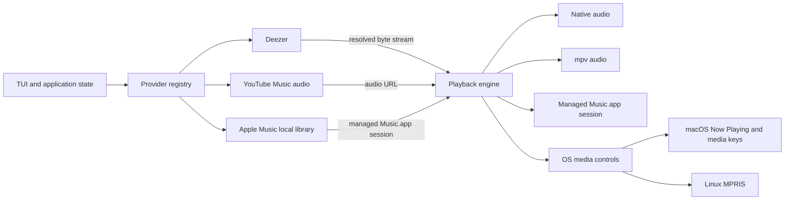

# Architecture

`amp-tui` separates the catalog and authentication for each service from audio playback. Provider features are exposed through Go interfaces, and the UI only offers controls the active provider or playback engine supports.

## Main packages

- `cmd/amp-tui`: flags, provider registration, configuration loading, and program startup.
- `internal/provider`: provider, authenticator, stream source, managed audio, and optional radio contracts.
- `internal/provider/deezer`, `youtube`, `applemusic`: service catalog, sign-in, metadata conversion, and track resolution.
- `internal/core`: service-neutral track, playlist, quality, and audio format values.
- `internal/playback`: playback engine/session contract; `native` and `mpv` are engine implementations.
- `internal/mediactl`: OS playback status and media-key bridges. macOS uses the Swift helper; Linux exports MPRIS over the user session bus.
- `internal/config` and `internal/secrets`: user preferences and credential persistence.
- `internal/tui` and `internal/app`: presentation and application state.

## Catalog playback and managed playback

A streaming provider implements `provider.StreamSource`. `Resolve` returns a `provider.Source` containing either playable bytes or an audio URL, track metadata, quality, and seek information. The selected engine owns decoding and audio output. Deezer returns decrypted track bytes; YouTube resolves a short-lived audio URL through `yt-dlp`.

Apple Music implements `provider.ManagedAudioProvider`. The Music app owns the audio output; the provider sends commands and reports the current track and position. The shared playback interface allows the TUI to control both models while provider and engine capabilities determine which operations are available.

The playback engine setting is global: `auto`, `mpv`, or `native`. In automatic mode, macOS prefers the native engine. Linux uses mpv when it is available and otherwise falls back to native audio. YouTube requires mpv. Check dependencies with `amp-tui --doctor`.

All playback is audio-only. YouTube extraction skips downloads and mpv is started with video disabled; the app has no video mode.
